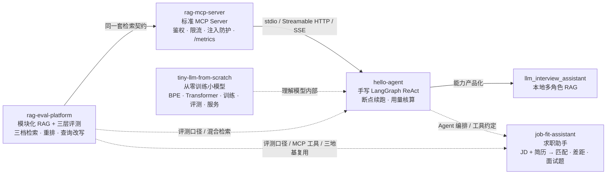

# LLM Agent / RAG 工程作品集

> 一条可复现的能力链：**检索与评测 → MCP 服务化（可运维 / 可审计） → Agent 编排（可中断 / 可核算） → 产品化落地**。
> 不是孤立 demo：检索链路被封装成标准 MCP 工具复用，Agent 负责多步决策，评测平台负责证明效果；
> 每一层都能用**一条命令**在本机跑出证据（`python demo_all.py`，9 步，约 180 秒）。

[](https://www.python.org/)
[](#实测指标)
[](LICENSE)

---

## 一分钟看懂



**主线一句话**：把「检索」做成可复用服务 → 被 Agent 调用 → 用评测平台量化效果。
**新补的一层**：把服务做成**可运维、可审计**的（鉴权 / 限流 / 健康检查 / 指标 / 注入防护），
把 Agent 做成**可中断、可核算**的（断点续跑 / 用量与成本），并且每一层都有**一条命令能现场证明**。
**再加两个新仓**：一个是**应用落地**（`job-fit-assistant`：JD + 简历 → 匹配与差距分析），
一个是**底层理解**（`tiny-llm-from-scratch`：不用任何预训练权重、从分词器到训练再到服务全链路自写）。

---

## 项目矩阵

| 项目 | 角色 | 核心能力 | 可验证证据 |
|---|---|---|---|
| [**rag-eval-platform**](https://gitee.com/tmlKevin/rag-eval-platform) · [GitHub](https://github.com/world-breaker/rag-eval-platform) | 检索与评测底座 | 模块化 RAG（切分/向量/检索/生成/评测）；三层指标（Recall·MRR / LLM-as-Judge / BLEU·ROUGE-L）；**BM25 + 向量 RRF 混合检索**；**三档检索模式**（纯向量 / 混合 / 混合+重排，外加 multi-query 与 HyDE 两档增强）；可选 Cross-Encoder 重排、查询改写 | 全量 **108 passed**；14 篇 / 10 篇两套评测集；**六档位质量 × 延迟实测落盘**（含「HyDE 在噪声库掉点」的负结果）；混合检索对照实验落盘（md + json） |
| [**rag-mcp-server**](https://gitee.com/tmlKevin/rag-mcp-server) · [GitHub](https://github.com/world-breaker/rag-mcp-server) | 服务化 + 可运维 | 官方 MCP SDK 的标准工具（`search_knowledge` / `knowledge_base_stats`）；**stdio / Streamable HTTP / SSE** 三种传输；**Bearer 鉴权 + 令牌桶限流**（429 + `Retry-After`）；**`/healthz` 只读快照 + `/metrics` Prometheus 指标**（零额外依赖）；**检索结果提示注入防护**（`<untrusted_data>` 隔离 + 可疑模式标注/中和 + 命中率指标）；DNS rebinding 防护配置 | 全量 **173 passed**；HTTP 压测 **20 并发 × 100 请求 = QPS 166.9 / p50 95ms / p95 180.5ms / p99 181.9ms / 错误率 0**，客户端 160 次调用 == 服务端 `tool_calls_total` 增量 160；`scripts/demo_http_security.py` 一条命令实测 401 / 429 / healthz / 注入标记（10 项全 PASS） |
| [**hello-agent**](https://gitee.com/tmlKevin/hello-agent) · [GitHub](https://github.com/world-breaker/hello-agent) | Agent 编排 | 手写 LangGraph ReAct（三字段状态）；韧性四档（不重试/退避重试/降级/熔断）；**工具并发**；**BM25 跨任务记忆**；**上下文压缩**；**checkpoint 断点续跑**（同 `thread_id` 续跑，不重放已完成步骤）；**用量与成本核算**（扫 trace 重算 token 与费用）；JSONL trace | 全量 **180 passed / 1 skipped**；4×0.2s 工具并发 0.2s vs 串行 0.8s；上下文压缩省 31% 字符；58 条量化评测集；断点续跑演示 **重放步数 = 0**；12 次运行累计 **49,635 tokens / $0.016382** |
| [**llm_interview_assistant**](../llm_interview_assistant) | 产品化 | Qwen2.5-3B + RAG + LoRA（0.5% 参数 / 68MB）+ 四角色 + 多轮记忆 + 内容安全，全本地推理 | RTX 4070 本机跑通；基座 vs 微调对比脚本 `benchmark.py` |
| [**job-fit-assistant**](https://gitee.com/tmlKevin/job-fit-assistant) · [GitHub](https://github.com/world-breaker/job-fit-assistant) | AI 应用落地 | JD + 简历 → 技能要求抽取 / 匹配分析（带**简历原句证据**）/ 差距与优先级建议 / 改写建议 / 预测面试题；**假绿防线**（词面命中不算命中：要求动作动词 + 量化结果 + 项目语境）；组合三个地基仓库（评测口径 / MCP 检索 / Agent 编排） | 全量 **61 passed**；评测集 = **12 份 JD 标注集**（9 份公开真实 JD + 3 份自写变体，119 条人工标注）× **4 份脱敏简历**；**123 条命中结论中假绿 0 次**；零第三方依赖即可跑核心链路 |
| [**tiny-llm-from-scratch**](https://gitee.com/tmlKevin/tiny-llm-from-scratch) · [GitHub](https://github.com/world-breaker/tiny-llm-from-scratch) | 从零训练小模型 | **不用任何预训练权重**，连分词器也从零训（纯 Python BPE，不 import `transformers`/`tokenizers`/`tiktoken`）；自写 Transformer（RMSNorm / RoPE / GQA / SwiGLU / 权重共享 / KV cache）+ 训练循环（AdamW + warmup/cosine + 梯度累积 + bf16 + OOM 自适应 + 断点续训）+ 采样 + HTTP 服务；「数据 → 分词器 → 模型 → 训练 → 评测 → 推理/服务」全流程跑通 | 全量 **37 passed**；**15.59M 参数**（15,586,176）/ **7,500 步** / 峰值显存 **1.67 GiB** / 吞吐 71,875 tok/s；val PPL **129.63 → 36.47**；**优于均匀 / 一元 / bigram 三条基线**（比 bigram 好 **7.68×**，loss 低 2.038 nats） |

---

## 实测指标（只写跑过的数）

| 实验 | 对照 | 结果 | 结论 |
|---|---|---|---|
| **六档位检索 · realistic 评测集** | 纯向量 / 混合 RRF / +重排 / +multi-query / +HyDE | 纯向量 R@3 **1.0**、MRR **0.9286**、热 p50 **0.62ms**；混合 RRF 召回相同；+重排 MRR→**1.0** 但热 p50 **995ms**；+multi-query MRR **0.9524**；+HyDE 无明显收益且热 p50 **12.6s** | 收益必须和延迟一起看：+重排用约 1600× 的热延迟换 7% 的 MRR |
| **六档位检索 · near_dup_stress 噪声库** | 同上 | 纯向量 R@3 **0.625**；纯 BM25 **1.0**；混合 RRF **1.0** / MRR **0.7708**；+重排 MRR→**1.0**；**HyDE 掉点到 R@3 0.75** | 噪声库上 HyDE 反而带入噪声——**不是所有「高级技巧」都加分**，这条负结果同样是结论 |
| **HTTP 压测**（20 并发 × 100 请求） | 官方 MCP 长连接客户端 | QPS **166.9** / p50 **95ms** / p95 **180.5ms** / p99 **181.9ms** / 错误率 **0**；客户端 160 次调用 == 服务端 `tool_calls_total` 增量 **160** | 客户端与服务端计数交叉验证一致 → 「压出来的 QPS」不是客户端自欺 |
| **HTTP 鉴权 / 限流** | 无 token / 错 token / 正确 token / 洪水 | `/mcp` 无 token **401 + `WWW-Authenticate`**；错 token **401**；正确 token 通过并成功调用 `search_knowledge`；限流 0.5 rps / burst 10 下连打 18 次 = **401×10 之后 429×8 + `Retry-After: 2`**；同一时刻 `/healthz` 仍 **200** | 限流排在鉴权**之前**：猜 token 的洪水被挡在协议解析前；探针路径豁免，不会被误杀 |
| **提示注入防护**（20 条对抗语料） | 对抗语料 vs 正常语料 | **20/20 条对抗语料全部命中**并给出规则 id；**11/11 条正常对照 + 5 篇真实知识库文档全部零误伤**；命中片段被 `⟦…⟧` 中和，正文**不删除** | 模式匹配只能抬高攻击成本 + 让上层有据可依，不等于彻底解决（见诚实边界） |
| **断点续跑** | 跑到一半进程被 kill → 同 `thread_id` 续跑 | **重放步数 = 0**（已完成步骤不重算）；第 2 次运行只补跑失败的那一步；trace 里有 `resume_detected` | checkpoint 落磁盘，续跑是「新进程读旧状态」，不是内存里重放 |
| **用量与成本核算** | 扫 trace 重算 vs 手工记账 | 12 次运行累计 **49,635 tokens / $0.016382**（按 `deepseek-chat` 单价表） | 成本任何时刻都能从 trace 重算，不会出现「账本和日志对不上」 |
| **混合检索 · 噪声语料**（10 篇含近义副本） | 纯向量 vs BM25+向量 RRF | Recall@3 **0.625 → 1.0**；MRR **0.479 → 0.771** | 近义副本场景下，BM25 的精确匹配纠正向量的分数分散 |
| **混合检索 · 干净语料**（14 篇话题区分度大） | 同上 | 两者均 Recall@3=1.0、MRR=0.9286 | 强向量模型已近天花板，**混合检索不是银弹** |
| **工具并发** | 串行 vs `asyncio.gather` | 4 个各 0.2s 的工具：**0.8s → 0.2s** | 总延迟 ≈ 最慢工具；`gather` 保序保证协议一一对应 |
| **记忆召回** | overlap vs BM25 | 长度归一化场景：短记忆 **2.89** vs 长记忆 **1.15**；overlap 打平 1.0/1.0 | BM25 选中「短而精确」的记忆，不被长文档带偏 |
| **上下文压缩** | 压缩前 vs 后 | 18 条消息 **2643 → 1824 字符（-31.0%）** | 只压内容不删消息，`tool_call_id` 配对完整 |
| **测试** | — | hello-agent **180 passed / 1 skipped**；rag-mcp **173 passed**；rag-eval **108 passed**；job-fit **61 passed**；tiny-llm **37 passed** —— 合计 **559 passed / 1 skipped** | 行为契约测试，不是快照 |
| **MCP 传输** | stdio / HTTP / SSE | 三模式可用，HTTP 端到端实测 | 远程部署 / 多客户端复用 |

> 评测口径：检索用**文档级标注**（`relevant_sources`），跨切分策略可比；生成层 LLM-as-Judge 需要模型，未配置时回退启发式评分（仅跑通流程，不作为正式指标）。

---


> **两套 CI 都接了、都在跑**：GitHub Actions（徽章是真跑状态）+ **Gitee Go**（`.workflow/MasterPipeline.yml`，同一批命令、同一套口径；构建记录在仓库页「流水线」里，需登录可见）。

## 一键跑通（离线，实测 119~191 秒）

**全新克隆要两条命令**（第一条装依赖，第二条跑验证）：

```bash
# 在 portfolio-site/ 目录下
python demo_all.py --bootstrap    # 建 per-repo venv 装依赖：实测 47.8s，幂等（第二次 0.1s 复用）
python demo_all.py                # 跑 9 步：全新克隆实测 119.4s
```

没 bootstrap 就直接跑，会在**开跑前**被拦下（退出码 2 + 提示缺哪个仓的 `.venv`），不会跑到第一步才炸。

**为什么必须是「每仓一个 .venv」**：hello-agent 要 `mcp==1.30.0`（`langchain-mcp-adapters==0.3.2` 的硬约束），
rag-mcp-server 要 `mcp==2.3.0` —— 同一 site-packages 装不下，**单一环境无解**。

**还差两个机器级前置条件**（`--bootstrap` 也解决不了）：

1. **HF 模型缓存约 3.5GB**：`bge-small-zh-v1.5`（91.9MB）**必需**，缺了第 5 步必失败；
   `mmarco-mMiniLMv2`（469.9MB）缺则降级纯向量；`Qwen2.5-1.5B-Instruct`（2955.4MB）只有可选步需要。
   门面强制离线模式、**不会自动下载**，缺了就打印现成的 `hf download` 命令。
2. **机器级 Python 3.12 预装** torch(CUDA)/transformers/sentence-transformers/gradio/pyarrow
   （两个 venv 用 `--system-site-packages` 复用，故不用再下 GB 级 wheel）。

**实测闭环**：全新克隆 → `--bootstrap` → 9/9 全绿 → 五仓 `git status --porcelain` **0 字节**
（346 个跟踪文件归一化换行符后逐字节等同 HEAD）。clone 7.2s + bootstrap 47.8s + demo 119.4s ≈ **3 分钟**。

它会依次执行 **9 步**（每步有进度与耗时，失败即停）：

| # | 步骤 id | 内容 | 提取到的指标（本机实测） |
|---|---|---|---|
| 1 | `agent-tests` | `hello-agent` 全量测试（离线，脚本化假模型） | `180 passed / 1 skipped` |
| 2 | `agent-memory` | 跨任务记忆演示（写入 → 召回 → 无关不注入） | `[OK]` |
| 3 | `agent-resume` | **断点续跑演示**（跑到一半被 kill → 同 `thread_id` 续跑） | 重放步数 **0** |
| 4 | `agent-usage` | **用量与成本汇总**（扫 trace 重算 token 与费用） | 12 次运行 / **49,635 tokens** / **$0.016382** |
| 5 | `eval-hybrid` | `rag-eval-platform` 混合检索对照实验（缓存 BGE，离线） | 噪声语料 Recall@3 **0.625 → 1.0** |
| 6 | `mcp-tests` | `rag-mcp-server` 全量测试（含 Streamable HTTP 端到端） | `173 passed` |
| 7 | `mcp-security` | **HTTP 安全演示**（真起服务子进程：401 / 429 / healthz / metrics / 注入防护） | 安全项 **10/10** |
| 8 | `jobfit-tests` | `job-fit-assistant` 全量测试（求职助手，纯 CPU 离线，不联网不调 API） | `61 passed` |
| 9 | `tiny-llm-tests` | `tiny-llm-from-scratch` 全量测试（从零训练项目，纯 CPU 离线） | `37 passed` |

全 9 步实测 **119~191s**（全新克隆实测 119.4s；本机连跑多次 135.2s / 158.1s / 177.9s / 191.2s，波动主要来自 `agent-tests` 那一步 26s↔50s；
模型与依赖已缓存，换机器首次运行会多花模型加载/下载时间）。
后两步（8 / 9）是**纯 CPU、秒级**的，两个新仓统一用系统 Python 3.12
（tiny-llm 没有自己的 `.venv`；job-fit 的 `.venv` 是 `--system-site-packages` 建的，与系统解释器等价；
tiny-llm 单测要 `import torch`）。

只想跑其中几项：

```bash
python demo_all.py --only eval-hybrid,agent-memory
python demo_all.py --only agent-resume,agent-usage,mcp-security   # 只看新能力
python demo_all.py --only jobfit-tests,tiny-llm-tests             # 只跑两个新仓的测试
python demo_all.py --skip-tests                                   # 跳过四个 pytest 步骤
python demo_all.py --list                                         # 列出全部步骤 id
```

**可选步骤 `eval-generation`**（默认不跑：要 GPU；**实测约 106 秒**——门面步骤耗时 106.4s / 墙钟 121.2s，首次需下载/加载模型会更久；门槛不在于慢，而在于「不是每台机器都有 GPU」，所以不塞进默认门面）：

```bash
python demo_all.py --only eval-generation   # 生成层忠实度评测（离线两臂：规则判据 + 本地 1.5B）
python demo_all.py --all                    # 连可选步骤一起跑
```

> **门面只做验证，不生产数据**：第 5 步的实验脚本会按**当天日期**把结果写进
> `rag-eval-platform/experiments/results/`，门面会在该步跑完后**自动清掉本步新产生**的产物（跑前已存在的文件一律不动），
> 因此**跨天重跑也不会弄脏任何仓库**（实测：清 2 个 / **五仓库 0 改动**）。
> 第 8 / 9 步只跑 pytest，副作用只有 `.pytest_cache/` 与 `__pycache__/`，两个新仓的 `.gitignore` 都已忽略它们。
> 确实想留存产物时加 `--keep-artifacts`，或直接跑 `python experiments/run_hybrid_comparison.py`。

单独演示某一层（都在各自仓库里，可重复跑）：

```bash
cd rag-mcp-server && .venv/Scripts/python.exe scripts/demo_http_security.py   # HTTP 安全 10 项实测
cd hello-agent    && .venv/Scripts/python.exe scripts/demo_resume.py          # 断点续跑（重放步数 = 0）
cd hello-agent    && .venv/Scripts/python.exe scripts/usage_report.py         # 累计 tokens 与成本
cd job-fit-assistant       && python -m pytest -q                            # 求职助手 61 passed
cd tiny-llm-from-scratch   && python -m pytest tests -q                      # 从零训模型 37 passed
```

各仓库独立运行方式见各自 README。

---

## 建议阅读顺序（面试前 30 分钟）

1. **[hello-agent 架构与韧性](https://gitee.com/tmlKevin/hello-agent#5-可靠性设计与能力增强本项目的重点)**
   —— 三字段状态、四档失败处置、并发与记忆，回答「Agent 到底怎么工程化」。
2. **[rag-eval 架构与评测口径](https://gitee.com/tmlKevin/rag-eval-platform/blob/master/docs/architecture.md)**
   —— 为什么切三层指标、为什么用文档级口径、RRF 为什么不做加权求和。
3. **[rag-mcp 传输、鉴权与注入防护](https://gitee.com/tmlKevin/rag-mcp-server#55-三种传输方式stdio--streamable-http--sse)**
   —— 同一组工具如何挂到 stdio / HTTP；鉴权 / 限流 / `/healthz` / `/metrics` 的实测证据
   就在 `rag-mcp-server/scripts/demo_http_security.py` 一条命令里（401 → 429 → 注入标记，全部带响应片段）。
4. **[hello-agent 量化评测](https://gitee.com/tmlKevin/hello-agent#7-测试)**
   —— 完成率 / 工具选择准确率 / 失败恢复率 / 领域外诚实率。
5. **新能力的两条证据链** —— `hello-agent/scripts/demo_resume.py`（断点续跑：重放步数 = 0）
   与 `hello-agent/scripts/usage_report.py`（12 次运行 49,635 tokens / $0.016382）；
   `rag-eval-platform` 的六档位「质量 × 延迟」表（含 HyDE 在噪声库掉点这类负结果）。
6. **[job-fit-assistant 求职助手](https://gitee.com/tmlKevin/job-fit-assistant)**
   —— 六步功能与**假绿防线**（词面命中 ≠ 会这个技能），回答「AI 应用怎么落到真需求上」。
7. **[tiny-llm-from-scratch 从零训练](https://gitee.com/tmlKevin/tiny-llm-from-scratch)**
   —— 纯 Python BPE + 自写 Transformer + 训练循环，回答「大模型内部到底怎么跑起来的」。

---

## 三分钟讲法（电梯稿）

> "我用 LangGraph 手写了一个最小 ReAct Agent：状态只有 messages / steps / status 三个字段，
> 循环靠路由函数决定继续调工具还是收尾。
> 工具层做了四档失败处置：参数错不重试、瞬时故障退避重试、重试耗尽降级、连续失败熔断；
> 每次运行落 JSONL trace，能回放整条决策链。
> 检索链路被我单独封装成标准 MCP Server，本地用 stdio、远程用 Streamable HTTP，Cursor / Claude 都能接；
> 评测平台负责量化检索效果——混合检索在含近义副本的噪声语料上把 Recall@3 从 0.625 拉到 1.0。
> 另外做了工具并发（4 个 0.2s 工具从 0.8s 降到 0.2s）、跨任务记忆（JSONL + BM25 召回注入），
> 以及上下文压缩（18 条消息省 31% 字符，且不破坏 tool_call 配对）。
> 服务化那层不只是「能跑」：HTTP 上加了 Bearer 鉴权（无 token 401）、令牌桶限流（超限 429 + Retry-After）、
> 只读 /healthz 与不鉴权的 /metrics；压测 20 并发 × 100 请求 = QPS 166.9、p95 180ms、错误率 0，
> 而且客户端调了 160 次、服务端 tool_calls_total 也正好 +160，两边对得上。
> 检索结果里的文档一律当**不可信数据**：13 类提示注入手法全部命中并标注规则，正常语料零误伤。
> Agent 侧做了 checkpoint 断点续跑——进程被杀后同 thread_id 续跑，**重放步数 = 0**；
> 扫 trace 就能重算用量（12 次运行 49,635 tokens / $0.016382），不靠手工记账。
> 另外两个仓补的是另外两件事：一个是**应用落地**——`job-fit-assistant` 把 JD 和简历变成一份能直接用的求职报告
> （抽技能要求 → 带简历原句证据的逐条匹配 → 差距与优先级 → 改写建议 → 预测面试题），关键设计是**假绿防线**：
> 简历里出现过这个词不等于会这个技能，所以命中还得有动作动词、有量化结果、在项目语境里，123 条命中结论里假绿 0 次。
> 另一个是**底层理解**——`tiny-llm-from-scratch` 不用任何预训练权重，连分词器都是纯 Python 从零训的 BPE，
> Transformer、训练循环、采样、HTTP 服务全自己写，15.59M 参数训到 val PPL 36.47，优于均匀/一元/bigram 三条基线。
> 整套是 Agent + RAG + MCP + 评测 + 应用落地 + 从零训练 的递进作品集，不是孤立 demo；每一项都能用一条命令现场跑给你看。"

---

## 诚实边界（面试被追问时的安全答案）

- **知识库规模小**：14 篇 / 10 篇评测集，指标用于回归与对照，**不代表线上分布**；万级 chunk 需换 Faiss/向量库。
- **混合检索有适用区间**：干净语料上收益有限，噪声/近义副本语料上才显著；重排已实现但默认关闭（需下载模型）。
- **记忆召回是字面重叠**（英文词 + 中文单字/二元组），不是语义召回；单机 JSONL，未做多进程并发写锁。
- **MCP HTTP 的安全层是「够用级」不是生产级**：静态共享 token（不是 OAuth 2.1、没有密钥轮换）、
  进程内令牌桶（多副本要放到网关层限流）、默认只绑 `127.0.0.1`；**Dockerfile 已写但本机未验证**。
- **提示注入防护会误报、也会被绕过**：检测是模式匹配（讨论注入的文档、base64 大块都会被标记），
  换措辞/换语言/多段拼接即可绕过；它只负责抬高攻击成本、让上层有据可依，
  不能替代上层 Agent 的信任边界与工具权限控制。
- **求职助手的评测样本量小**：n = 12 份 JD × 4 份简历，比例**只应作为量级参考**；标注是单人标注、无第二标注者复核；
  真实求职里「哪版简历更好」还取决于公司、薪资、地域、投递时机，这些都不在评测范围内。
- **从零训练的小模型没训完、也没学到知识**：只跑到 step 7,500（目标 12,000，且是被外部终止的），
  val PPL 36.47 仍远高于真实语料分布；它学到的是**语言结构与长程语法**，不是知识；
  PPL 之外没有做系统的人工/任务评测，8 条生成样例只是能力示意。
- **不是生产系统**：没有部署、没有用户量；所有数字均来自本机真实运行，可复现。

---

## 目录

```text
<同一父目录>/                        # 六个仓平级摆（门面对「同级 + 上一级」两处都会找）
├── portfolio-site/               # ← 本仓：对外门面（总说明 + 图文单页 + 一键跑通脚本）
│   ├── README.md                 #   本文件：能力链 + 指标 + 阅读顺序
│   ├── index.html                #   图文单页（投屏 / 发链接；GitHub Pages 直接可看）
│   ├── demo_all.py               #   一键离线跑通五仓库 9 步（进度/耗时/失败即停/指标提取）
│   └── .gitignore
├── hello-agent/                  # 手写 ReAct Agent（LangGraph）· checkpoint 续跑 · 用量核算
├── rag-eval-platform/            # 模块化 RAG + 三层评测 + 三档检索（可选重排/改写/HyDE）
├── rag-mcp-server/               # RAG 检索 → 标准 MCP Server（stdio/HTTP/SSE · 鉴权/限流/注入防护）
│   └── scripts/demo_http_security.py   # 一条命令实测 401/429/healthz/metrics/注入标记
├── job-fit-assistant/            # 求职助手：JD + 简历 → 匹配 / 差距 / 改写 / 预测面试题
├── tiny-llm-from-scratch/        # 从零训练小模型：纯 Python BPE + 自写 Transformer + 训练 + 评测 + 服务
└── ../llm_interview_assistant/   # 本地多角色 RAG 产品化
```

> **六个仓怎么摆**：把 `portfolio-site` 与另外五个仓 clone 到**同一个父目录**下即可。
> 门面的 `resolve_repo()` 会在「同级目录」和「上一级目录」两处找五仓 → 两种摆法都支持，
> clone 顺序、先放哪都无所谓。

## License

MIT
